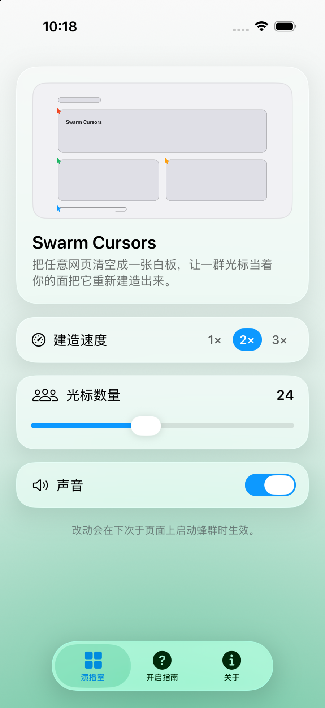
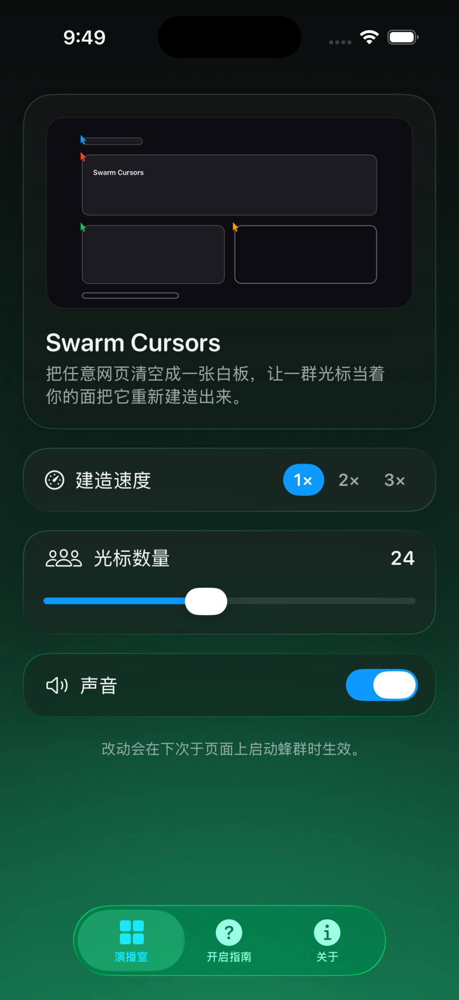
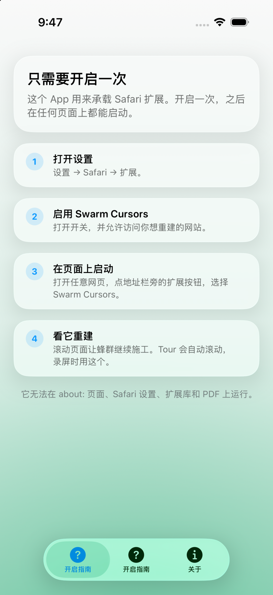
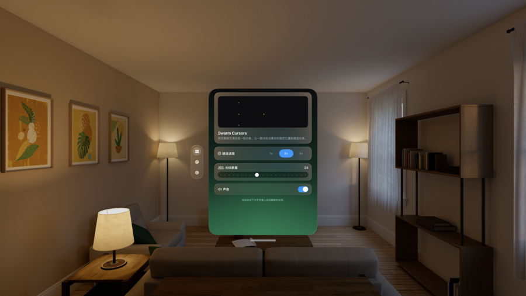

# Swarm Cursors — v1.0

一个 Safari 扩展 + 原生 App：点一下，整个网页被清空成白板，然后几十个彩色光标当着你的面把它重新「建造」出来。

原版是 Chrome 商店上的 [Swarm Rebuild](https://chromewebstore.google.com/detail/swarm-rebuild/diaeaocnhdhbknkbfbnkjikfcgokainm)（约 9000 用户 / 4.7 分），这里把它搬到了 Apple 全平台，并补了一套原生 App。

- **iOS / iPadOS 15+**
- **macOS 11+**
- **visionOS 1.0+**

版本号 **1.0**，目录 `v1.0`。

---

## v1.0 架构：画的是真实网页，不是副本

原版的做法是「白板 + 网页副本」：把 DOM 克隆一份画在画布上，画完再把副本换回真实网页。那一换就是可见的接缝，而且副本点不动。v1.0 把**材料**换掉了，动画本身没动：

- `content/mask.js`（`document_start`）把 `body *` 的 opacity 归零，页面变成自己的背景色 —— 没有白纸、没有色差、没有矩形接缝。
- 引擎照旧画：选框、拉伸、字符逐字输入、母版复制、等比移动、随后替换内容。区别是**每个任务的落点就是真实元素**：光标封边的瞬间，那个元素淡入回来。
- 所以没有「画完再换回原网页」这一步 —— 你看着被画出来的，一直就是它本身。
- opacity 不影响命中测试：建造过程中就能点击、跳转、输入、滚动。

**总开关**：工具栏按钮单击切换 ON/OFF，徽章显示状态；OFF 时扩展在任何站点都不注入、不遮罩、不启动引擎。App 演播室第一行是同一个开关，写进 App Group 的 `enabled`，扩展读取设置时采纳并广播给所有标签。

**实时增删**：新出现的节点（登录框、toast）出生即被藏住，派空闲光标飞过去拉框量尺寸，框完才淡入；被移除的节点克隆一个幽灵固定在原位，宽度从右往左收成 0，像被擦掉。

**文字与框的一条铁律**：rect 任务完成时若元素内含文字、而文字任务还没画到，先把框压住（最多 1.4s），等文字落地那一刻框和字一起出现。文字元素还没有文本内容（懒渲染/字体未就绪）时同样压住，避免画出一堆空框。

**没有光标就不画**：引擎 1.8 秒没出现、或出现后 3.8 秒还没开始画（站点拦截、脚本没跑），整页一次性交还，不做逐元素浮出。

---

## v0.3 更新：首页真实小型网页 + 实时 Swarm 建造引擎预览

在 Studio 首页的 Hero 预览区，不再使用硬编码的静态 SVG 轮廓假动画，而是**完整实现了一套微型化的真实网页与 Swarm 建造引擎**：

1. **真实小型网页 DOM（Mini Webpage）**：
   - 包含完整的现代 Web 结构：导航栏 Brand/Logo、Nav 链接、CTA 按钮、Hero 渐变胶囊 Badge、主标题、描述文本、操作按钮以及 3 列特性卡片。
   - 真实 HTML + CSS 布局，支持系统的明亮/深色模式自适应切换。
2. **实时 Swarm 建造引擎（DOM Snapshot & Rebuild Engine）**：
   - **真实 DOM 扫描提取**：递归测量小网页中所有盒模型与文本节点的位置（`getBoundingClientRect`）与样式属性。
   - **多光标协同建造**：生成带名字（Ada, Linus, Grace, Alan 等）与专属颜色的 Figma 风格 SVG 虚拟光标。
   - **矢量拉伸与打字机效果**：光标协同绘制元素选框（带高光边框、控制手柄与尺寸标签），并以打字机动画逐字键入真实文本。
   - **Go-Live 真实呈现**：建造完成后无缝交叉淡入到真实可交互网页，随后散开光标进入下一轮巡航。
3. **设置项实时联动**：
   - 预览组件通过 WebKit Bridge 与 App 内的设置项深度绑定。
   - 在 Studio 界面调节**建造速度（1×/2×/3×）**、**光标数量（6~48 个）**与**声音开关**时，顶部的微型网页预览会**即时响应**并动态调整建造节奏与蜂群密度。

---

## 截图

| iOS 浅色 | iOS 深色 | iOS 指南 | visionOS |
|---|---|---|---|
|  |  |  |  |

---

## 为什么是 15 / 11

原先设到 iOS 13 / macOS 10.15，但 **Safari Web Extension 本身的下限就是 iOS 15 / macOS 11**，而 App 的部署目标不能低于它嵌入的扩展。所以整个工程统一抬到这里。

抬高之后少了一大堆东西：

| 之前（iOS 13） | 现在 |
|---|---|
| `@UIApplicationMain` + `SceneDelegate` + `NSApplicationMain` | 单个 SwiftUI `App` |
| `LaunchScreen.storyboard` + pbxproj 补 `platformFilter = ios;` 的 postgen 脚本 | `UILaunchScreen` 一个字典 |
| `Symbol` 包一层给 macOS 10.15 垫文字 glyph | `Image(systemName:)` 直接可用 |
| `IconLabel` / `ExternalLink` 手写降级 | `Label` / `Link` 直接可用 |
| `edgesIgnoringSafeArea` | `ignoresSafeArea` |
| visionOS 单独走 SwiftUI 分支 | 三平台同一个入口 |

`tools/postgen.py` 已删除，`make project` 现在只有 `xcodegen generate` 一步。

---

## 逐层降级，不是一降到底

地板是 iOS 15 / macOS 11 / visionOS 1.0，但那只是地板。每项能力按自己的可用性取最高档，集中在 `App/Compat.swift`：

| 能力 | 最高档 | 中间档 | 下限 |
|---|---|---|---|
| 表面材质 | `glassEffect`（iOS 26 / macOS 26） | `.ultraThinMaterial`（iOS 15 / macOS 12） | 淡色填充 + 描边（macOS 11） |
| visionOS 表面 | `glassBackgroundEffect`（1.0 起） | — | — |
| 玻璃分组 / 形变 | `GlassEffectContainer`（iOS 26） | 直接排列 | 同左 |
| 数字滚动 | `contentTransition(.numericText())`（iOS 16） | — | 直接跳变 |
| 符号切换动画 | `contentTransition(.symbolEffect)`（iOS 17） | — | 直接替换 |
| 触感反馈 | `sensoryFeedback`（iOS 17 / visionOS 26） | `UISelectionFeedbackGenerator` | — |
| 语义字号 | `Font.system(_:design:weight:)`（iOS 16） | — | `Font.system(size:weight:design:)` |
| 强调色 | `.tint`（iOS 15 / macOS 12） | — | `.accentColor`（macOS 11） |
| Tab bar 收起 | `tabBarMinimizeBehavior`（iOS 26） | — | 常驻 |
| 主按钮 | `.glassProminent`（iOS 26） | 实心胶囊 | 同左 |

注意 macOS 11 是个特殊档：材质从 macOS 12 才有，所以那一档走「淡色填充 + 描边 + 阴影」。iOS 侧因为地板就是 15，永远至少有材质。

---

## 语言跟随 App，不跟随浏览器

三个地方各说各的，这里统一到一处：

1. App 启动时把**自己实际运行的语言**写进 App Group 的 `lang`：
   `Bundle.main.preferredLocalizations.first` —— 系统「设置 → App → Swarm Cursors → 语言」的单独覆盖改的就是它，用 `Locale.current` 会拿到设备语言，覆盖会失效
2. `SafariWebExtensionHandler` 优先返回这个值，取不到才退回扩展进程自己的 locale（比如 App 从没启动过）
3. `background.js` 把它交给页面，`tools/src/head.js` 据此选 EN / ZH 词典，HUD 全部跟着变；工具栏提示也由 `action.setTitle` 在运行时改写，跟 HUD 保持一致

扩展的 `_locales/{en,zh_CN}` 仍然保留，管的是 **manifest 层的名字和商店描述**——那部分由浏览器在 JS 跑起来之前就解析了，改不了。页面里能看见的一切都跟 App。

## 开启指南按平台分开

Safari 的扩展入口三个平台完全不一样，所以不是一段话糊过去：

- **iOS**：设置 → Safari → 扩展 → 打开 Swarm Cursors → 允许网站
- **macOS**：Safari 里按 **⌘,**（或菜单栏 Safari → 设置）→ 扩展 → 勾选
- **visionOS**：设置 → App → Safari → 扩展 → 打开

macOS 上没有「打开 App 设置」按钮——那个按钮在 macOS 上没意义，直接删了。快捷键 ⌥⇧S 的卡片也只在 macOS 出现；iOS 和 visionOS 没有键盘绑定，画出来是骗人。

文案在 `App/{en,zh-Hans}.lproj/Localizable.strings`，键名 `guide.ios.*` / `guide.mac.*` / `guide.vision.*`。

---

## 演播室的预览是真的在跑

不再是 SwiftUI `Canvas` 画的假动画，而是一个 640×360 的真实小页面，用 `WKWebView` 加载 `App/Resources/swarm-mini.html`：

- 每个框按周长用 `stroke-dashoffset` 一点点描出来（就是扩展里「钢笔拖框」那个动作）
- 标题逐字符打出来
- 框画完后填充淡入
- 全部完成 → 停留 → 清空 → 循环

一份文件，约 180 行，没有依赖。`prefers-reduced-motion` 时只画一次不循环，`prefers-color-scheme` 跟着系统深浅色。

---

## 背景只有一种颜色

之前蓝 / 紫 / 绿三色一起上，看着像糖果店。现在只有一个绿：

- 底部最实，往上线性衰减到透明
- 底部再叠一层同色径向渐变做柔和的光池
- 有材质时用 0.42，没材质（macOS 11）收到 0.24——没有材质可以折射的强色只会糊成颜料

代码在 `App/Design.swift` 的 `AuroraBackground`。

---

## 目录结构

```
v0.2/
├── project.yml                  XcodeGen 工程定义
├── SwarmCursors.xcodeproj       生成产物，不要手改
├── App/
│   ├── Compat.swift             能力阶梯（全部降级逻辑集中在这里）
│   ├── Design.swift             设计令牌 + 单色背景 + 玻璃卡片
│   ├── SwarmCursorsApp.swift    单个 SwiftUI App 入口
│   ├── SwarmSettings.swift      App Group 共享设置
│   ├── RootView.swift           三个标签
│   ├── StudioView.swift         预览 + 速度 / 光标数 / 声音
│   ├── GuideView.swift          分平台开启指南
│   ├── AboutView.swift          致谢 + GitHub 按钮
│   ├── PreviewWebView.swift     WKWebView 容器
│   ├── Resources/swarm-mini.html  真在跑的微缩动画
│   └── {en,zh-Hans}.lproj/
├── Extension/                   Safari Web Extension 的 Swift 壳
├── web-extension/               扩展本体（引擎 + 双语 HUD）
├── tools/
│   ├── build-extension.mjs      17 条补丁的构建脚本
│   └── src/{head,boot}.js
└── icon/                        黑白线稿图标源文件
```

改完 `project.yml`：

```bash
make project      # = xcodegen generate
```

---

## 构建

```bash
make ios            # iOS Simulator
make macos
make visionos       # 设备
make visionos-sim   # 模拟器（generic/platform=visionOS 出的是设备包，装不进模拟器）
make device         # 真机，带 -allowProvisioningUpdates
```

四个目标都验证过：

| 目标 | MinimumOSVersion |
|---|---|
| iOS Simulator | 15.0 |
| visionOS Simulator | 1.0 |
| macOS | 11.0 |
| 扩展 (appex) | 15.0 |

`DEVELOPMENT_TEAM` 钉在 `project.yml` 里（`Q42CQ5VP5A`），`xcodegen generate` 不会冲掉。

### 报 `unable to read input file '.../Provisioning Profiles/<UUID>.mobileprovision'`

不是授权问题，是 DerivedData 里的死引用。确认那个 UUID 不在磁盘上之后：

```bash
rm -rf ~/Library/Developer/Xcode/DerivedData/SwarmCursors-*
xcodebuild -project SwarmCursors.xcodeproj -scheme SwarmCursors \
  -destination 'generic/platform=iOS' -configuration Debug \
  -allowProvisioningUpdates build
```

---

## 图标

`AppIcon.icon` 放在工程根目录（Icon Composer 的原始文档，五个图层：紫色光标、蓝色选框、珊瑚色光标、绿色光标、背景）。

`project.yml` 里显式引用它：

```yaml
    sources:
      - path: App
      - path: AppIcon.icon
        buildPhase: resources
```

**工程里没有任何 App 图标的 PNG**。`Assets.xcassets` 只剩 `AccentColor` 一个 colorset，`AppIcon.appiconset` 已删除，`ASSETCATALOG_COMPILER_APPICON_NAME` 也去掉了——`actool` 直接吃 `folder.iconcomposer.icon` 这个类型。

构建产物里出现的 `AppIcon60x60@2x.png` 之类是 **actool 编译 `.icon` 的输出**，不是源文件：部署目标定在 iOS 15，旧系统要位图兜底，所以必须生成。源工程始终只有 `.icon`。

## 已知限制

- **Liquid Glass 只在 iOS 26 / macOS 26 出现**；更早的系统是系统材质，观感不同但布局完全一致
- **macOS 11 没有材质 API**，那一档是淡色卡片
- 扩展不能在 `about:`、Safari 设置、扩展库和 PDF 上运行
- iOS 上效果运行期间禁用了双指缩放（`touch-action: none`）
- 长页面封顶约 4000 层 / 40000px

---

## 来源与授权（重要）

- 上游扩展：[Swarm Rebuild](https://chromewebstore.google.com/detail/swarm-rebuild/diaeaocnhdhbknkbfbnkjikfcgokainm)（v1.1.0，2026-11-05，约 9000 用户，4.7/5）。
- 源码：[DhvanilPatel/swarm-cursors](https://github.com/DhvanilPatel/swarm-cursors)（约 1800 stars）。
- 原始创意：[Joel Califa 的 Swarm](https://califa.github.io/swarm-site/)。光标形象、群集运动、建造编排都是 Joel 的设计。

**授权状态：上游 README 明确写的是 `License: None yet.`，而且作者说明动画引擎大量改编自 Joel Califa 的原作，后者同样没有给出明确许可。** 公开仓库不等于 MIT。

因此本仓库是按「本地研究 / 自用」定位的衍生作品：

- 可以自己编译、自己装、自己录屏；
- **不要**把这些代码重新发布、上架 App Store 或商用；
- 真要分发，先取得 Dhvanil Patel 与 Joel Califa 的书面许可，或者把动画机制按描述独立重写。

## 技术形态

引擎本身就是一段不依赖 Chrome 的 Web API 代码（`getComputedStyle` / `requestAnimationFrame` / Web Audio / Pointer Events / Canvas / SVG），因此同一份核心可以跑在三种壳里：Safari Web Extension（macOS / iOS / visionOS）、Userscript（`Userscript版本/`）、以及任意浏览器扩展。差异只在外壳：注入方式、设置通道、工具栏开关。

关于页的 GitHub 按钮指向在 `App/AboutView.swift` 顶部的 `repository` 一行，换成自己的仓库即可。
